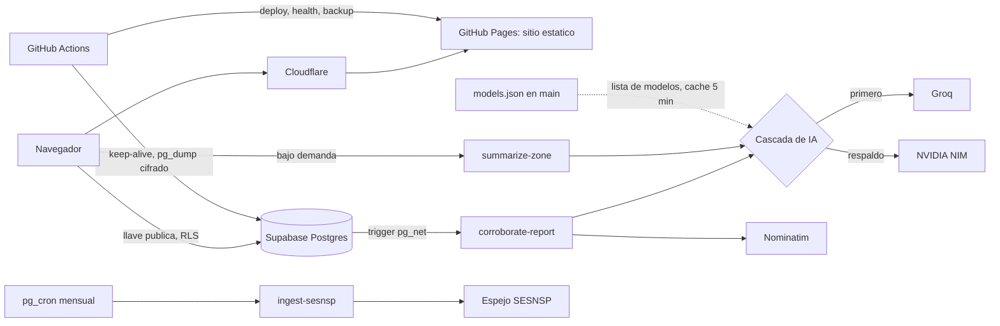

# Radar Urbano

[](https://github.com/GerardoLucero/radar-urbano/actions/workflows/ci.yml)
[](https://github.com/GerardoLucero/radar-urbano/actions/workflows/deploy.yml)
[](LICENSE)

Radar comunitario de seguridad en México: fraudes telefónicos, robos y asaltos. Se reporta en segundos, sin registro, y se consulta antes de contestar una llamada o pasar por una zona. Sitio: [radarurbano.org](https://radarurbano.org).

Es un proyecto personal. Este repositorio se publica como ejemplo de cómo operar un servicio pequeño con presupuesto cero: infraestructura gratuita, CI/CD, backups, monitoreo y una capa de IA con respaldo.

## Resumen

- **Frontend estático** (HTML + JS modular) en GitHub Pages, detrás de Cloudflare.
- **Supabase** (Postgres con RLS, `pg_cron`, Edge Functions en Deno) como backend.
- **IA** para clasificar reportes, detectar duplicados, corroborar números repetidos y resumir una zona. Cascada Groq → NVIDIA NIM con salida validada con zod.
- **Datos oficiales** (SESNSP) como contexto histórico por municipio.
- **Asistentes de IA**: pueden consultar números y preparar reportes que la persona confirma, por enlaces directos o por un servidor MCP (ver `agentes.html`).
- **Operación**: CI en cada PR, deploy con smoke test, monitoreo con ntfy, keep-alive de Supabase y backup nocturno cifrado.

## Arquitectura



## Decisiones de diseño

| Tema | Decisión |
|---|---|
| Privacidad | No se guarda la IP: solo un hash con sal por reporte. La ubicación del GPS se difumina a ~1 km antes de guardarse. |
| Abuso | Límite de reportes por hora y por IP en la base, límite por nombre reportado y moderación manual para reportes que identifican a una persona. |
| Confianza | El puntaje cuenta reportantes independientes; es una cota por conteo, no una probabilidad. "Sin reportes" nunca se presenta como "seguro". |
| IA no confiable | El texto del usuario va como dato dentro de etiquetas, se trunca, se quitan URLs y la salida se valida con zod. Ante duda, el reporte queda en revisión y no se publica. |
| Costo cero | GitHub Pages, Supabase gratuito y modelos gratuitos. Un keep-alive diario evita la pausa del proyecto. |
| Cambiar de modelo | Se edita `models.json` en `main`; las funciones lo leen en runtime y no hay que redesplegar. Un workflow diario prueba cada modelo y avisa si alguno se retira. |
| Supply chain | Acciones fijadas por SHA de commit, Dependabot, gitleaks y versiones y SRI fijos en las dependencias del navegador. |

## Estructura

| Ruta | Contenido |
|---|---|
| `index.html`, `site-assets/` | Sitio y lógica del cliente |
| `supabase/migrations/` | Esquema y endurecimiento (ver `supabase/README.md` para el orden de aplicación) |
| `supabase/functions/` | Edge Functions y módulos compartidos (`_shared/llm.ts`, `model-config.ts`) |
| `supabase/evals/` | Casos de evaluación de la IA, incluidos adversariales |
| `.github/` | CI, deploy, health, backup y scripts de prueba |
| `mcp/` | Servidor MCP para asistentes de IA: consultar un número y preparar un reporte que la persona confirma |
| `llms.txt`, `openapi.json`, `agentes.html` | Descubrimiento y guía para asistentes de IA |
| `docs/funcionalidades.md` | Detalle de funcionalidades y de la arquitectura |
| `docs/agentes.md` | Diseño del acceso para asistentes de IA y reglas |
| `RUNBOOK.md`, `MODERATION.md`, `docs/restore.md` | Operación, moderación y restauración de backups |

## Desarrollo

```bash
# Funciones: tipos y pruebas (Deno 2)
deno check supabase/functions/*/index.ts
deno test supabase/functions

# Sitio: se sirve tal cual
python3 -m http.server 8000
```

El CI de cada PR corre html-validate, sintaxis del JS, gitleaks, `deno check`, validación del sitemap y el armado del sitio.

## Estado

- Operativo: sitio, mapa, reportes, búsqueda, CI/CD, monitoreo, keep-alive y backups.
- En el repositorio y pendientes de aplicar en producción: la migración de endurecimiento de reportes por nombre y la versión actual de las Edge Functions (ver `supabase/README.md`).
- Pendiente: revisión por un abogado de los borradores de privacidad, términos y ARCO (`privacidad.html`, `terminos.html`, `arco.html`), y mostrar la capa SESNSP en el mapa.

## Seguridad y licencia

Para reportar una vulnerabilidad, ver [SECURITY.md](SECURITY.md). El código se publica bajo licencia MIT (ver [LICENSE](LICENSE)). Los reportes enviados por usuarios no forman parte de la licencia.
